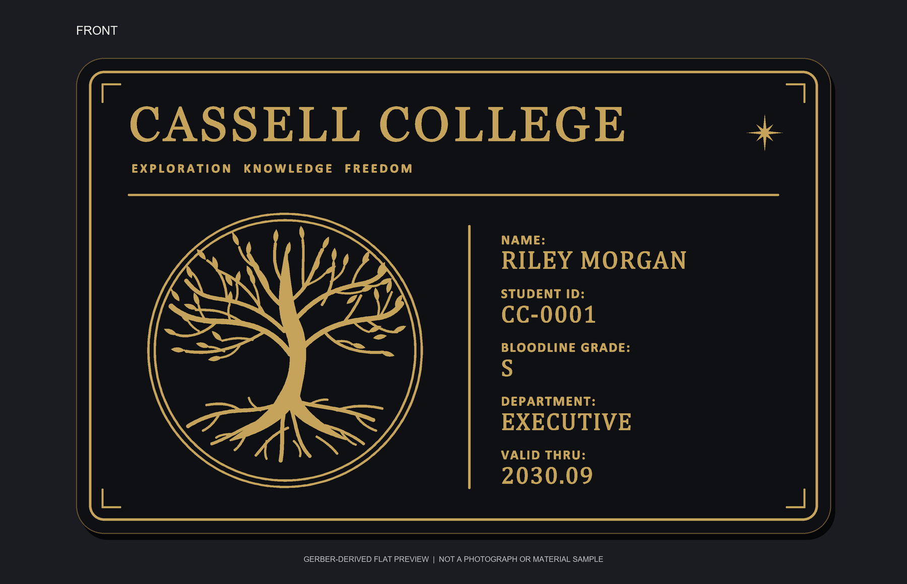
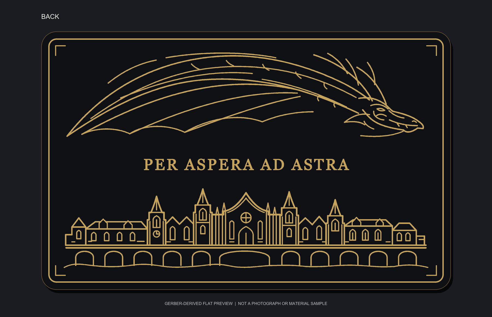

# Cassell College PCB Card

An unofficial, non-commercial fan-made PCB art project inspired by *Dragon Raja*. The card carries a fictional Cassell College identity and is intended as a two-sided PCB art and fabrication study. It has **no electronic circuit function**.

## Gallery

These are flat previews rendered from the public Gerber artwork. They are not photographs, EasyEDA screenshots, or calibrated solder-mask/ENIG material samples.

| Front | Back |
|---|---|
|  |  |

The public copy uses the fictional details **RILEY MORGAN / CC-0001**. The original private identity and source artwork are not included.

## Design specifications

| Property | Value |
|---|---|
| PCB type | Decorative, double-sided PCB art |
| Layers | 2 copper layers |
| Board size | 85.6 × 54.0 mm |
| Corner radius | R3.18 mm |
| Material | FR-4 |
| Board thickness | 1.0 mm target |
| Copper weight | 1 oz target |
| Solder mask | Matte black target, both sides |
| Surface finish | ENIG target, both sides |
| Design software | EasyEDA Pro (嘉立创EDA专业版) |

Color, thickness, copper weight, and finish are order parameters; Gerber artwork does not set them.

## Design features

- World Tree emblem and Cassell College identity
- Fictional student details, including Bloodline Grade S
- Dragon line art and Gothic architecture
- Latin motto: **PER ASPERA AD ASTRA**
- Copper artwork with matching solder-mask openings on both sides

The public card text is English/Latin only. Editable-text SVGs, outlined SVGs, and flattened artwork SVGs are included. The [EasyEDA Pro source archive](eda/project/EasyEDA_Editable_Source.zip) includes the project file, editable PCB document, and DFM polygon JSON. Run `scripts/restore_easyeda_source.ps1` after cloning to expand them into their working paths. The EasyEDA Pro project contains a PCB document only: no schematic, components, nets, vias, or drilled holes are part of this art-only design.

## Project structure

```text
design/                 Editable text, outlined artwork, and fictional card data
assets/                 Independent vector artwork used by the design sources
eda/project/            EasyEDA Pro project source archive
scripts/                 Restore the editable EasyEDA source files
eda/geometry/           Editable and DFM-adjusted SVG geometry
eda/tools/              Geometry, Gerber, and preview utilities
gerber/                 Copper/mask layers, board outline, ZIP, validation
images/                 Gerber-derived flat front/back gallery previews
docs/                   Manufacturing, privacy, and validation notes
reports/                Public build validation summary
```

## Manufacturing

`gerber/Cassell_College_PCB_Card_Gerber.zip` contains Top Copper, Bottom Copper, Top Solder Mask, Bottom Solder Mask, and Board Outline. There is no drill file because the design has no holes. The board outline may need to be selected explicitly as the profile when uploading a no-hole board.

Suggested order settings are 2-layer FR-4, 85.6 × 54 mm, 1.0 mm, 1 oz copper, black solder mask on both sides, and ENIG. Confirm current factory capabilities, pricing, and production data before ordering. This public revision's Gerbers were generated from the sanitized native PCB fill geometry by the included converter; they were **not exported in the EasyEDA GUI**. Parsing confirms that the Gerber artwork matches the public native polygon geometry and that copper/mask pairs match. **This sanitized PCB has not been reopened in EasyEDA for a fresh GUI DRC. Do not treat this release as factory-approved or production-ready until you open it in EasyEDA Pro, run DRC, and review the manufacturer's preview.**

See [Manufacturing and validation notes](docs/Manufacturing_Notes.md) for the checks performed and the remaining steps.

## Development workflow

Visual concept → editable vector design → PCB polygon geometry → geometry/DFM checks → Gerber generation → fabrication review.

Codex and local scripts assisted with SVG generation, geometry conversion, polygon checks, and documentation. No electrical schematic or circuit was invented for this decorative board.

## Disclaimer and rights

This is an unofficial fan-made project inspired by *Dragon Raja*. It is not affiliated with or endorsed by the original creators or rights holders. Cassell College and related fictional elements are not represented as real institutions. No official authorization is claimed.

No license is included. Rights to source-world names, settings, and any third-party reference material remain with their respective rights holders. Reference images and original private project files were excluded from this public copy; no permission to redistribute third-party material is implied.
